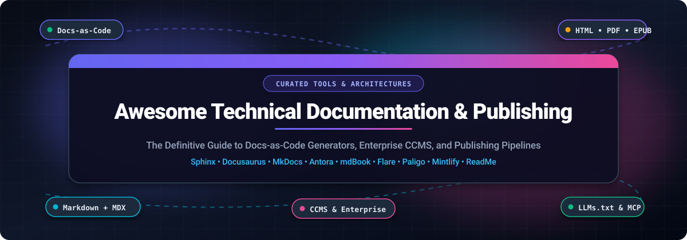

<p align="center">
  
</p>

<p align="center">
  <a href="https://github.com/ishandutta2007/Awesome-Awesome-Awesome"></a>
  <a href="https://discord.gg/jc4xtF58Ve"></a>
  <a href="https://github.com/ishandutta2007/Awesome-Technical-Documentation-Publishing/stargazers"></a>
  <a href="https://github.com/ishandutta2007/Awesome-Technical-Documentation-Publishing/network/members"></a>
  <a href="LICENSE"></a>
  <a href="https://github.com/ishandutta2007/Awesome-Technical-Documentation-Publishing/pulls"></a>
  <a href="https://github.com/ishandutta2007"></a>
</p>

---

# 📚 Awesome Technical Documentation & Publishing

> **A comprehensive, SEO-optimized curated directory of enterprise SaaS solutions, Component Content Management Systems (CCMS), Docs-as-Code generators, and multi-format technical publishing pipelines.**

Welcome to the definitive guide to modern **Technical Documentation and Publishing** systems. Whether you are building an interactive API reference, publishing regulatory PDF manuals, creating a developer knowledge base, or maintaining a multi-channel enterprise CCMS, this ecosystem guide compiles the leading commercial software and top-starred open-source engines.

---

## 📑 Table of Contents

- [🌐 Sector Overview & Market Dynamics](#-sector-overview--market-dynamics)
- [🏢 SaaS & Hosted Commercial Platforms](#-saas--hosted-commercial-platforms)
- [🛠️ Open-Source GitHub Projects](#️-open-source-github-projects)
  - [Top Docs-as-Code & Static Site Generators](#top-docs-as-code--static-site-generators)
  - [Specialized Format Converters & Enterprise XML Engines](#specialized-format-converters--enterprise-xml-engines)
- [🔍 Architectural Selection Matrix: Docs-as-Code vs. CCMS](#-architectural-selection-matrix-docs-as-code-vs-ccms)
- [❓ Frequently Asked Questions (FAQ)](#-frequently-asked-questions-faq)
- [🤝 How to Contribute](#-how-to-contribute)
- [⚖️ Disclaimer](#️-disclaimer)
- [⭐ Star History](#-star-history)
- [💖 Support & Community](#-support--community)

---

## 🌐 Sector Overview & Market Dynamics

The global technical documentation and publishing software market is estimated at **$2.8B to $3.6B in 2025–2026** and is projected to expand to **$5.8B–$6.4B by 2031** at a compound annual growth rate (**CAGR of ~10.5%**). Growth is propelled by the rapid expansion of developer APIs, Developer Experience (DevEx) initiatives, stringent compliance standards in aerospace/pharma/manufacturing, and the urgent requirement for AI-readable documentation structures (such as `llms.txt` and Model Context Protocol / MCP servers).

In terms of industry concentration, the market is **moderately to highly fragmented rather than a winner-take-all monopoly**:

- **Regulated Enterprises & Heavy Industry:** Maintain multi-decade deployments on XML-based structured authoring systems and CCMS platforms (e.g., Adobe FrameMaker, MadCap Flare, Paligo) where single-source truth, audit trails, and multi-channel PDF/print delivery are legal imperatives.
- **Modern SaaS & Developer Tooling:** Gravitate toward docs-as-code static site generators (Docusaurus, VitePress, Hugo, Starlight) and modern AI-native developer hubs (Mintlify, GitBook, ReadMe) that embed directly in Git workflows and CI/CD pipelines.

Because no single architecture satisfies both high-velocity GitHub Markdown workflows and complex DITA/XML component reuse, specialized solutions thrive side-by-side across both enterprise and open-source domains.

---

## 🏢 SaaS & Hosted Commercial Platforms

The table below compiles leading hosted documentation and publishing platforms, **sorted in descending order by company scale (revenue / market valuation)**. Pricing reflects baseline starting tiers without hidden guesswork, and free tier limits specify exact allowances or trial parameters.

| 🏢 Product / Platform | 🏢 Company & Scale (Valuation / Revenue) | 💰 Pricing (Starting Paid Tier) | 🎁 Free Tier / Free Trial Limits | 🎯 Key Focus & Target Audience |
| :--- | :--- | :--- | :--- | :--- |
| **[Adobe FrameMaker](https://www.adobe.com/products/framemaker.html)** | **Adobe Inc.**<br>• Public (NASDAQ: `ADBE`)<br>• **~$23.77B Annual Revenue** (FY2025)<br>• ~$140B–$220B Market Cap | **$29.99 / author / month**<br>*(or $359.88 / author / year prepaid annually)* | **30-day fully functional free trial**<br>*(Local desktop install; no credit card required; 0 permanently free tier)* | Long-standing enterprise standard for structured XML, DITA, DocBook, and high-volume technical manuals. |
| **[Mintlify](https://mintlify.com)** | **Mintlify, Inc.**<br>• **$500M Valuation**<br>• $67M Funding (Series B led by a16z)<br>• **~$23M ARR** | **$450 / month**<br>*(billed annually at $5,400/yr, or $540/mo monthly)* | **Free Forever plan** for up to **5 editor seats**, custom domain (`mintlify.site` or custom), Git sync, MDX editor, search, API playground, MCP server; plus **14-day free trial of Pro** | Modern AI-native developer documentation with interactive API playgrounds, live MDX previews, and LLM context endpoints. |
| **[MadCap Flare](https://www.madcapsoftware.com/products/flare/)** | **MadCap Software**<br>• Battery Ventures Majority Investment<br>• **~$200M+ Valuation**<br>• **~$15M–$20M Annual Revenue** | **$3,150 / author / year**<br>*(billed annually for desktop authoring subscription)* | **30-day fully functional free trial**<br>*(Complete desktop feature access; no credit card required; 0 permanently free tier)* | The enterprise technical authoring benchmark for single-sourcing, conditional text, and multi-channel publication (HTML5, PDF, Word, EPUB). |
| **[Paligo](https://paligo.net)** | **Paligo AB**<br>• **~$116M Valuation**<br>• $29M Growth Round (GRO Capital & A&D)<br>• **~$11.3M ARR** | **$15,000 / year**<br>*(Business plan baseline for 2 authors + 2 translation languages)* | **14-day guided sandbox trial**<br>*(Provisioned upon request following software demo with sales engineering; 0 self-serve free tier)* | Cloud-native Component Content Management System (CCMS) for structured reuse, translation management, and XML publishing without local servers. |
| **[ReadMe](https://readme.com)** | **ReadMe, Inc.**<br>• **~$50M–$100M Valuation**<br>• $10.3M Funding (Accel, Y Combinator)<br>• **~$8M–$11M ARR** | **$250 / month**<br>*(billed annually for Pro tier)* | **Free Forever Starter plan** for **1 project**, **1 published version**, custom domain, bi-directional Git sync, interactive API explorer, and basic AI; plus **14-day free trial of Pro** | Interactive API hubs with live endpoint testers, metrics, customer telemetry, changelogs, and OpenAPI / Swagger sync. |
| **[Document360](https://document360.com)** | **Kovai.co**<br>• **~$30M–$32.5M Parent Company ARR**<br>• $10M+ Standalone Product ARR<br>• Bootstrapped (300+ employees) | **$149 / month**<br>*(billed annually for Standard tier)* | **Free Forever plan** for up to **2 team accounts**, **1 knowledge base** (up to 50 articles, basic search); plus **14-day free trial** on paid plans without credit card | Turnkey knowledge base software for SaaS and customer support teams with WYSIWYG/Markdown editing, analytics, and versioning. |
| **[Oxygen XML Author](https://www.oxygenxml.com/xml_author.html)** | **Syncro Soft SRL**<br>• Independent European Enterprise Vendor<br>• **~$10M–$20M Estimated Revenue**<br>• Bootstrapped | **$280 / year**<br>*(Commercial Named User annual subscription; or ~$450 perpetual license with 1-yr SMP)* | **30-day unrestricted free trial**<br>*(Complete feature set and plugin access upon email registration; 0 permanently free tier)* | Specialized visual and code-level XML authoring suite with native validation and transformations for DITA, DocBook, TEI, and Relax NG. |
| **[GitBook](https://www.gitbook.com)** | **GitBook Inc.**<br>• Lean Product-Led Growth (PLG)<br>• **~$40M–$50M Estimated Valuation**<br>• **~$4M ARR** (~35–40 employees) | **$65 / site / month**<br>*(billed annually) + **$12 / user / month*** | **Free Forever plan** for **1 user** on `*.gitbook.io` subdomain with unlimited traffic and public publishing (excludes custom domain & team collaboration; capped at 10 AI queries/week); plus **30-day trial** of paid tiers | Collaborative docs-as-code documentation with Git branch synchronization, WYSIWYG editing, and public knowledge spaces. |

---

## 🛠️ Open-Source GitHub Projects

Open-source publishing tools power high-velocity docs-as-code teams. Below is the curated catalog, **sorted in descending order by GitHub stargazers**. Each project includes a real-time star badge linking to its official stargazers page.

### Top Docs-as-Code & Static Site Generators

1. **[Hugo](https://github.com/gohugoio/hugo)** [](https://github.com/gohugoio/hugo/stargazers)  
   *The world's fastest static site engine.* Written in Go, Hugo builds thousands of pages in milliseconds. Paired with popular technical documentation themes like [Docsy](https://github.com/google/docsy) or [Hugo Book](https://github.com/alex-shpak/hugo-book), it powers major open-source documentation hubs including Kubernetes.

2. **[Docusaurus](https://github.com/facebook/docusaurus)** [](https://github.com/facebook/docusaurus/stargazers)  
   *The React-powered documentation site generator by Meta.* Combines the speed of static HTML with client-side React hydration. Features out-of-the-box versioning, internationalization (i18n), Algolia DocSearch integration, and full MDX support for embedding interactive React UI components directly into Markdown files.

3. **[Pandoc](https://github.com/jgm/pandoc)** [](https://github.com/jgm/pandoc/stargazers)  
   *The universal markup converter.* Written in Haskell, Pandoc is the Swiss Army knife of multi-format technical publishing. It converts flawlessly between Markdown, reStructuredText, HTML, LaTeX, PDF, EPUB, DocBook, Word docx, and man pages. Essential for custom publishing pipelines requiring programmatic output transformations.

4. **[Slate](https://github.com/slatedocs/slate)** [](https://github.com/slatedocs/slate/stargazers)  
   *The legendary three-panel API documentation generator.* Inspired by Stripe's iconic developer docs, Slate keeps code samples, terminal requests, and textual explanations cleanly separated across responsive, intuitive side-by-side columns.

5. **[Docsify](https://github.com/docsifyjs/docsify)** [](https://github.com/docsifyjs/docsify/stargazers)  
   *A magical documentation site generator without static HTML compilation.* Docsify dynamically loads and renders Markdown files on the fly on the client side. No build steps, no Node build pipelines — simply deploy an `index.html` file and your Markdown documents to GitHub Pages.

6. **[Material for MkDocs](https://github.com/squidfunk/mkdocs-material)** [](https://github.com/squidfunk/mkdocs-material/stargazers)  
   *The gold-standard enterprise theme for MkDocs.* Delivers instant offline search, dark/light toggle, code annotations, mathematical typesetting (MathJax/KaTeX), versioning dropdowns, and deep accessibility compliance.

7. **[MkDocs](https://github.com/mkdocs/mkdocs)** [](https://github.com/mkdocs/mkdocs/stargazers)  
   *Fast, simple Markdown static site generator.* Configured via a single `mkdocs.yml` file, MkDocs includes a lightning-fast local development server with auto-reload, built-in search, and seamless one-command deployment to GitHub Pages via `mkdocs gh-deploy`.

8. **[mdBook](https://github.com/rust-lang/mdBook)** [](https://github.com/rust-lang/mdBook/stargazers)  
   *The official Rust project book generator.* Implemented in Rust for blazing-fast compilation, mdBook compiles structured Markdown files into clean, searchable, responsive online books. Features integrated code block execution, print-friendly CSS, and CLI scaffolding.

9. **[VitePress](https://github.com/vuejs/vitepress)** [](https://github.com/vuejs/vitepress/stargazers)  
   *Vite & Vue-powered static site generator.* The spiritual successor to VuePress, VitePress provides instant server start times, dead-simple Markdown-with-Vue authoring, and optimized production builds. Powers the official documentation for Vue.js, Vite, Rollup, and Vitest.

10. **[Nextra](https://github.com/shuding/nextra)** [](https://github.com/shuding/nextra/stargazers)  
    *The Next.js and MDX documentation framework by Vercel.* Combines the full power of Next.js App Router, React Server Components (RSC), and MDX with file-system routing and automatic sidebar generation.

11. **[Fumadocs](https://github.com/fuma-nama/fumadocs)** [](https://github.com/fuma-nama/fumadocs/stargazers)  
    *The performant full-stack documentation framework for Next.js.* Features integrated full-text search (Orama/FlexSearch), OpenAPI interactive playground generation, automated type generation, and TypeScript code highlighting.

12. **[Starlight](https://github.com/withastro/starlight)** [](https://github.com/withastro/starlight/stargazers)  
    *The documentation framework built on Astro.* Ships zero client-side JavaScript by default, resulting in stellar Lighthouse performance scores. Features built-in internationalization, Pagefind search, Markdown/MDX authoring, and table-of-contents generation.

13. **[Sphinx](https://github.com/sphinx-doc/sphinx)** [](https://github.com/sphinx-doc/sphinx/stargazers)  
    *The battle-tested documentation generator behind Python and Linux kernel.* Translates reStructuredText and MyST Markdown into multi-format deliverables: HTML websites, production-grade LaTeX PDFs, EPUB, and Unix man pages. Its `autodoc` extension extracts live docstrings from codebase modules, while `intersphinx` allows cross-referencing across independent repositories.

14. **[Asciidoctor](https://github.com/asciidoctor/asciidoctor)** [](https://github.com/asciidoctor/asciidoctor/stargazers)  
    *A fast, open-source text processor and publishing toolchain for AsciiDoc.* Converts plain-text AsciiDoc into HTML5, DocBook, PDF, and EPUB. Provides native file inclusion, attributes, conditional execution, and mathematical formulas without XML verbosity.

### Specialized Format Converters & Enterprise XML Engines

15. **[DITA Open Toolkit (DITA-OT)](https://github.com/dita-ot/dita-ot)** [](https://github.com/dita-ot/dita-ot/stargazers)  
    *The open-source publishing engine for the OASIS DITA standard.* Converts DITA XML maps and topic components into responsive HTML5, PDF (via Apache FOP), Eclipse Help, and RTF deliverables.

16. **[SiSU](https://github.com/sisudoc/sisu)** [](https://github.com/sisudoc/sisu/stargazers)  
    *Command-line document structuring and publishing system.* Generates plain text, HTML, XHTML, XML, EPUB, LaTeX, and PDF from minimal markup based on an indexed object-numbering framework that guarantees citation consistency across formats.

17. **[Antora](https://gitlab.com/antora/antora)** *(Hosted on GitLab)*  
    *The multi-repository docs-as-code site generator for AsciiDoc.* Aggregates AsciiDoc documentation stored across distributed Git repositories and branches, compiling them into a unified, versioned technical documentation site.

---

## 🔍 Architectural Selection Matrix: Docs-as-Code vs. CCMS

```
+------------------------+------------------------------------+------------------------------------+
| Dimension              | Docs-as-Code (Sphinx/Docusaurus)   | Enterprise CCMS (Flare/Paligo)     |
+------------------------+------------------------------------+------------------------------------+
| Primary Syntax         | Markdown, MDX, reStructuredText    | DITA, DocBook, Structured XML      |
| Storage & Versioning   | Git (GitHub / GitLab / Bitbucket)  | Centralized Cloud Database / VCS   |
| Author Persona         | Software Engineers, DevRel Writers | Dedicated Technical Writers, L10n  |
| Multi-Format PDF       | LaTeX / Headless Chromium pipeline | Native visual PDF print engine     |
| License Cost           | $0 (Open Source, Self-Hosted)      | $350 - $15,000+ per author / year  |
| Content Reuse Model    | Partials, Git Submodules, Includes | Granular XML Topic/Snippet Re-use  |
+------------------------+------------------------------------+------------------------------------+
```

---

## ❓ Frequently Asked Questions (FAQ)

### 1. What is the Docs-as-Code philosophy?
**Docs-as-code** means authoring documentation using the same tools and workflows used for software development:
- Storing content in plain-text formats (**Markdown**, **reStructuredText**, or **AsciiDoc**).
- Versioning documentation alongside source code in **Git**.
- Automating testing (spell-checking, dead-link scanning, formatting) and deployments through **CI/CD pipelines**.
- Managing collaborative feedback via **Pull Requests (PRs)** and issue trackers.

### 2. When should a team choose Sphinx over Docusaurus or MkDocs?
- **Choose Sphinx** if you need **formal PDF books** alongside your website from a single plain-text source, or if your project requires automated API reference generation directly from Python source code docstrings via `autodoc`.
- **Choose Docusaurus** if your documentation doubles as a **marketing showcase**, requires interactive React/MDX components, or needs client-side SPA navigation.
- **Choose MkDocs (with Material)** if you want the **lowest learning curve**, clean YAML configuration, and an outstanding out-of-the-box search experience.

### 3. Why do aerospace, medical, and manufacturing companies still pay for MadCap Flare or Paligo?
Regulated industries have strict legal mandates for **audit trails**, **granular topic re-use** (updating a safety disclaimer once and propagating it to 500 equipment manuals), **multi-language translation memories**, and guaranteed millimeter-precise print PDF layouts that standard Markdown engines cannot easily replicate without heavy custom engineering.

---

## 🤝 How to Contribute

We welcome contributions from technical writers, documentation engineers, and open-source creators!

1. 🍴 **Fork the repository** on GitHub.
2. 🌿 **Create a feature branch**:
   ```bash
   git checkout -b feature/add-new-documentation-tool
   ```
3. 📝 **Add or edit entries in `README.md`**:
   - Maintain table formats and sorting criteria.
   - For SaaS tools: include verified starting prices, exact free tier/trial limits, and company scale metrics.
   - For open-source tools: include the shields.io social star badge linked to the stargazers page.
4. 🚀 **Submit a Pull Request** with a concise explanation of the changes.

---

## ⚖️ Disclaimer

- This repository is a **community-curated guide** intended for architectural research and product benchmarking.
- Product pricing, trial lengths, company valuations, and repository star counts represent verifiable market snapshots as of **2025–2026** and are subject to change by their respective vendors and maintainers.

---

## ⭐ Star History

[](https://star-history.dera.page/#ishandutta2007/Awesome-Technical-Documentation-Publishing&type=date&legend=top-left)

---

## 💖 Support & Community

Thank you for visiting **Awesome Technical Documentation & Publishing**! If this curated ecosystem guide helps your team discover the right tools and optimize your publishing pipelines:

- ⭐ **Star this repository** to bookmark it and help others discover it.
- 🍴 **Fork and contribute** your favorite docs tools, frameworks, and benchmarks.
- 📢 **Share** with your engineering, developer relations, and technical writing teams.
- ☕ **Support the maintainer**: If you would like to buy a coffee or sponsor ongoing research and curation, visit the [GitHub Sponsor Dashboard](https://github.com/sponsors/ishandutta2007).
